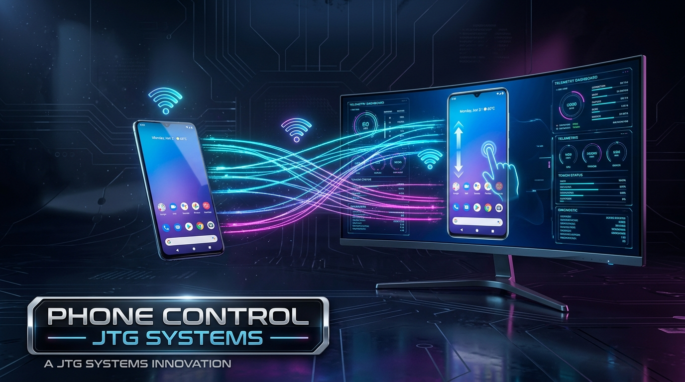

# 📱 Phone Control Project (v2.5 SOTA 2026)

<div align="center">



**Cross-Platform Android Remote Control, Low-Latency Screen Mirroring & Wireless ADB Manager**

[](https://opensource.org/licenses/MIT)
[]()
[](https://github.com/Genymobile/scrcpy)
[](https://jtgsystems.com)

*Mirror, control, automate, and manage Android smartphones and tablets with ultra-low latency, 60 FPS video, audio forwarding, and one-click wireless WiFi debugging.*

</div>

---

## ✨ Features

- 🎮 **Ultra Low-Latency Screen Mirroring**: 60 FPS 1080p/4K display mirroring powered by hardware-accelerated OpenGL and `scrcpy`.
- 📶 **One-Click Wireless ADB over WiFi**: Automatically switch USB-connected devices to wireless TCP/IP mode (`phone-control wireless`) and unplug the cable.
- ⌨️ **Full Keyboard & Mouse Control**: Type with your computer keyboard, copy-paste clipboard synchronization, and control the screen with precision mouse clicks and gestures.
- 🔊 **Direct Audio Forwarding**: Stream phone audio directly through your computer speakers or surround soundstage without extra cables.
- 📦 **Cross-Platform CLI & Launchers**:
  - **Linux & macOS**: Zero-dependency `phone-control.sh` script or global Python CLI (`pip install -e .`).
  - **Windows**: Fast `PHONECONTROL.BAT` with bundled ADB and scrcpy binaries.
  - **Web & Electron UI**: Modern web dashboard and Electron desktop app in `src/`.

---

## 🚀 Quick Start & Installation

### Option 1: Global CLI / Python (Linux, macOS, Windows)
```bash
git clone https://github.com/jtgsystems/Phone-Control-Project.git
cd Phone-Control-Project
pip install -e .

# Launch Screen Mirroring:
phone-control mirror
# or short alias:
pcp mirror
```

### Option 2: Linux & macOS Native Script
```bash
./phone-control.sh
```

### Option 3: Windows One-Click
Double-click **`PHONECONTROL.BAT`** in the project folder.

---

## 📖 CLI Commands

```bash
# List all connected Android devices (USB and WiFi)
phone-control devices

# Launch high-performance screen mirror
phone-control mirror

# Switch current USB device to Wireless WiFi mode (then unplug USB cable!)
phone-control wireless

# Connect to a phone's IP address directly over WiFi
phone-control connect 192.168.1.50
```

---

## 📱 How to Enable USB Debugging on Android

1. Open **Settings** > **About Phone**.
2. Tap **Build Number** 7 times until Developer Mode is unlocked.
3. Go to **Settings** > **System** > **Developer Options**.
4. Enable **USB Debugging** (and **Wireless Debugging** if on Android 11+).
5. Plug phone into PC and tap **"Always Allow from this Computer"** when prompted.

---

## 🏆 Created by JTG Systems

<div align="center">

<a href="https://jtgsystems.com">
  
</a>

**Engineered with pride by [JTG Systems](https://jtgsystems.com)**  
*Enterprise Systems Architecture, Custom Workstations & AI Solutions*

🌐 **Website**: [jtgsystems.com](https://jtgsystems.com)  
📞 **Contact**: (905) 892-4555  
☕ **Tips & Sponsorship**: `jtgsystems@gmail.com`

</div>

---

## 🔍 SEO Keyword Cloud & Search Tags

<details>
<summary><strong>Expand Search Engine Index & Compatibility Keywords</strong></summary>

### 🏷️ Search Queries & Tags:
`android phone control from pc` · `screen mirror android to linux` · `scrcpy wireless adb setup` · `control android phone with keyboard and mouse` · `android screen mirroring 60fps windows` · `wireless phone control wifi adb` · `stream android audio to pc` · `jtgsystems phone control project` · `free open source scrcpy gui` · `remote android management toolkit`

</details>

---

## 📜 License

MIT License © 2026 [JTG Systems](https://jtgsystems.com).
